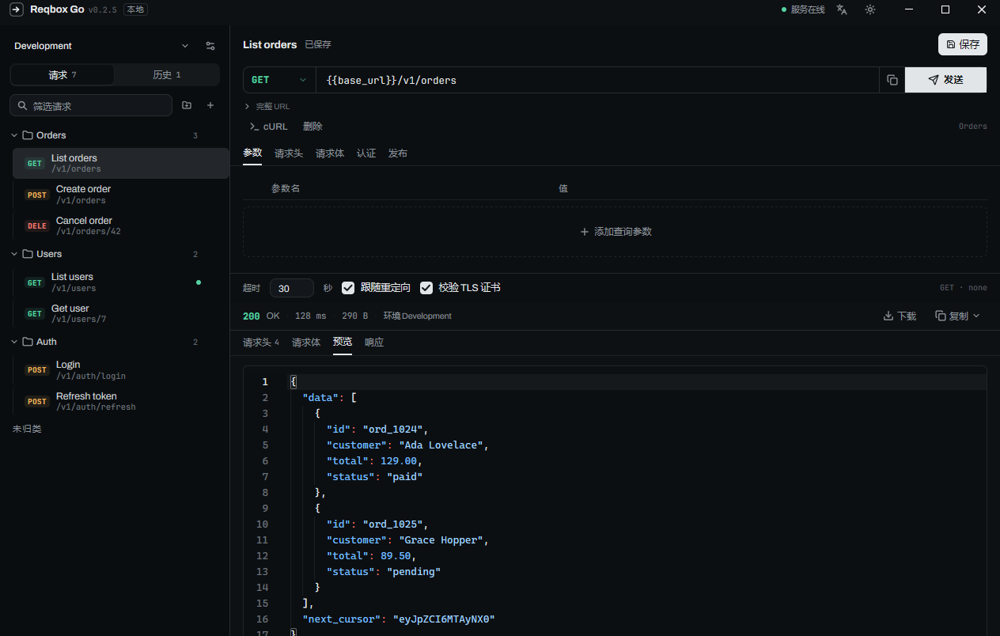
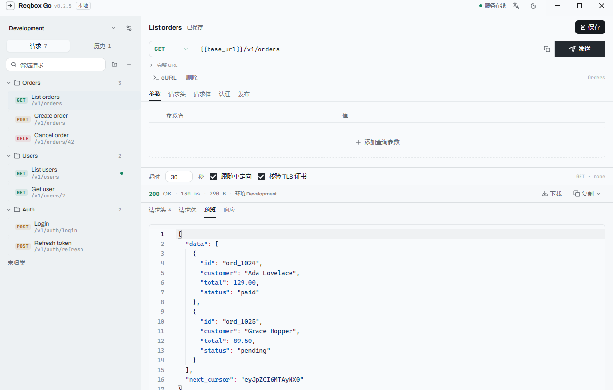
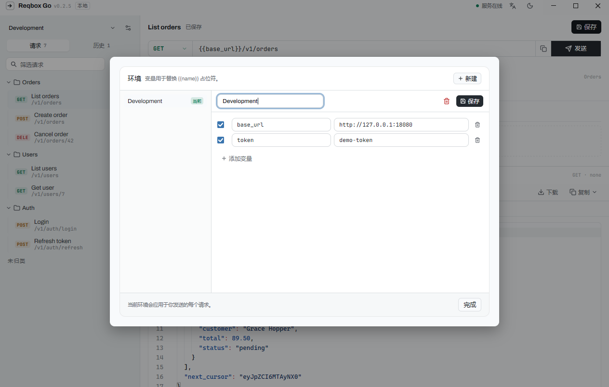

# Reqbox Go

[](https://github.com/iamartinlong/Reqbox-go/actions/workflows/ci.yml)
[](https://github.com/iamartinlong/Reqbox-go/releases)
[](https://go.dev/)
[](LICENSE)

Reqbox Go 是 Reqbox 的原生桌面客户端：使用 Go 与
[mygo](https://github.com/egoist/mygo) 即时模式 UI 直接绘制界面，不依赖 WebView；
内置 HTTP 执行器与 SQLite 存储，单文件即可运行。数据格式与 Reqbox 保持一致。

## 界面

| 深色主题 | 浅色主题 |
| --- | --- |
|  |  |



## 功能特性

- **请求编辑**：方法 / URL、Params、Headers、Form 键值表、Body、Auth，支持 cURL 导入
- **响应面板**：状态行、Headers / Request / Preview / Raw 视图、分阶段耗时
- **请求组织**：集合与文件夹、保存请求、历史记录与搜索
- **环境与变量**：多环境管理，`{{variable}}` 可在 URL、Header、Body 中替换
- **发布与 Mock**：发布请求、内置 Mock 网关
- **导入导出**：工作区以 JSON 导入 / 导出
- **原生体验**：明暗主题、English / 简体中文、单文件可执行
- **自动更新**：GitHub Releases 签名更新，支持增量（delta）下载

## 技术栈

| 模块 | 说明 |
| --- | --- |
| UI | mygo 原生即时模式 UI（无 WebView、无 cgo） |
| 存储 | `pkg/store`，SQLite（`modernc.org/sqlite`，纯 Go） |
| 网络 | `pkg/runner`，基于 `net/http` 的请求执行器 |
| 打包 | mygo build，NSIS 安装器，Ed25519 签名更新 |

## 环境要求

**运行安装版**：Windows 10 / 11 x64。无需安装 Go、Node、Python 或 WebView——Go 运行时
已静态链接进可执行文件（`CGO_ENABLED=0`），只依赖 Windows 自带的系统 DLL。

**从源码开发 / 构建**：

- Go 1.27.3 或更高（低版本会自动拉取对应工具链）
- 首次构建需要网络下载依赖

## 快速开始

```sh
# 开发运行
go run .

# 运行测试（pkg/store 与 pkg/runner）
go test ./...
```

本地构建可执行文件：

```sh
go build -o reqbox-go.exe .
```

## 构建与发布

发布使用的签名构建需要更新私钥（密钥不入库）：

```sh
MYGO_UPDATER_PRIVATE_KEY="$(cat /path/to/mygo-update.key)" \
  go run github.com/egoist/mygo/cmd/mygo build
```

产物位于 `build/windows-amd64/`：

- 可执行文件
- `<slug>-setup-<version>-amd64.exe`：NSIS 安装器
- `<slug>-<version>-windows-amd64.tar.gz`：更新归档
- `<slug>-<from>-to-<version>-windows-amd64.delta`：增量更新
- `update-windows-amd64.json`：签名后的更新清单
- `install.ps1`、`build/SHA256SUMS`：安装脚本与校验和

不提供私钥也能完成无签名构建，但安装版将收不到自动更新。发布时创建
`v<version>` tag，并将上述文件上传到对应的 GitHub Release。

## 自动更新

应用启动约 10 秒后检查更新，此后每日检查一次。更新清单与更新包使用 Ed25519
签名校验；存在旧版本增量包时只下载差异部分，失败会自动回退到完整包。更新源、
公钥与 tag 前缀配置在 `mygo.json` 的 `updates` 字段中。

## 配置

### mygo.json

| 字段 | 说明 |
| --- | --- |
| `name` / `identifier` | 应用内部名称与反向域名标识 |
| `version` | 当前版本，同时决定发布 tag（`v<version>`） |
| `windows.displayName` | Windows 快捷方式、安装器与应用列表中的显示名 |
| `updates` | 更新源（`github`）、tag 前缀与更新公钥 |

### 数据存储

SQLite 数据库文件为 `reqbox.db`，保存在系统用户配置目录下的应用数据目录中；
界面语言、主题、环境与历史记录均持久化于此。更新偏好保存在同目录的
`updater.json`。

## 项目结构

```
main.go              应用入口、窗口与全局状态
reqbar.go            请求编辑区（方法 / URL / KV / Body / Auth）
response.go          响应面板
sidebar.go           集合与历史侧栏
env.go               环境管理
publish.go           发布与 Mock
dialogs.go           对话框
i18n.go              多语言运行时
i18n_table.go        English / 简体中文文案
pkg/store            SQLite 存储（请求、集合、历史、环境、设置）
pkg/runner           HTTP 执行器（变量替换、超时、重定向、TLS）
icons/ fonts/        图标与内嵌字体
resources/           随应用分发的资源
mygo.json            打包与更新配置
.github/workflows/   CI
```

## 开发与 CI

```sh
go build ./...                                  # 编译检查
go vet ./...                                    # 静态检查
go run github.com/egoist/mygo/cmd/mygo vet .    # 原生 UI 生命周期检查
go test ./...                                   # 单元测试
```

`.github/workflows/ci.yml` 会在每次 push / pull request 时执行上述检查，并做一次
无签名的打包冒烟构建。

性能基准（不随 CI 默认运行）：

```sh
go test ./pkg/store -run '^$' -bench List -benchmem
go test . -run '^$' -bench RebuildRows -benchmem
```

## 快捷键

| 快捷键 | 功能 |
| --- | --- |
| `Ctrl + Enter` | 发送请求 |
| `Ctrl + S` | 保存请求 |
| `Ctrl + N` | 新建请求 |

## 国际化

界面内置 English 与简体中文，默认跟随系统语言，可在应用内切换。

## 许可证

本项目使用 [MIT License](LICENSE) 发布。第三方依赖、图标与字体资源遵循其各自许可证。
